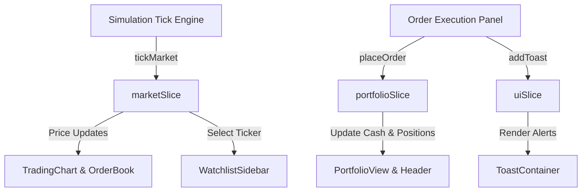

# 🪐 Orbit Trade — Real-Time Financial Trading Terminal & Simulation Engine

[](https://react.dev/)
[](https://redux-toolkit.js.org/)
[](https://vitejs.dev/)
[](https://greensock.com/gsap/)
[](LICENSE)

**Orbit Trade** is a high-performance, institutional-grade simulated paper trading terminal built with modern web technologies. Designed for zero-risk market practice, it delivers realistic Level-2 order book depth, responsive interactive candlestick charts, automated market tick engines, and instant order matching with deterministic P&L calculations.

---

## ⚡ Key Features

### 📈 1. High-Precision Candlestick Charts & Technicals
- Custom **HTML5 Canvas-based chart rendering** delivering 60 FPS price action rendering.
- Multiple timeframes (**1m, 5m, 15m, 1h, 1D**) with live candle formation.
- Interactive crosshairs, dynamic price coordinates, and historical volume overlays.
- Technical indicators including **Moving Averages (SMA/EMA)** and **RSI (Relative Strength Index)**.

### 📊 2. Live Level-2 Order Book & Spread Analytics
- Real-time bid/ask depth ladder displaying active price levels and cumulative volume bars.
- Live spread calculation and visual depth imbalance indicators.
- **One-Click Order Pad Fill**: Clicking any bid or ask price automatically populates the order execution pad.

### ⏱️ 3. Real-Time Market Simulation Engine
- Automated tick generator simulating Brownian price walks, volatility spikes, and liquidity clustering.
- Global simulation controls: Pause, resume, or adjust tick velocity at any time.
- Dynamic ticker marquee at the top bar with 24-hour volume and percentage delta tracking.

### 💼 4. Order Execution & Margin Management
- Supports **Market Orders**, **Limit Orders**, and optional **Stop-Loss / Take-Profit** triggers.
- Automatic margin calculation, buying power verification, and slippage simulation.
- Real-time order fill matching against active book depth with celebratory execution feedback.

### 💰 5. Portfolio Tracking & Realized P&L
- Real-time portfolio metrics: Net Equity, Cash Balance, Unrealized P&L, Realized P&L, and Margin Utilization.
- Asset allocation breakdown with interactive holdings management.
- Quick cash injection (+$10k) and one-click demo portfolio reset.

### 🔍 6. Multi-Asset Screener & Audit History
- Real-time screener filtering across US Equities, Crypto, and Tech sectors.
- Sortable metrics by 24h Change, Volume, High, and Low.
- Persistent Trade History logging every filled order with execution prices and timestamps.

---

## 🛠️ Architecture & State Management

Orbit Trade utilizes a normalized, predictable state container powered by **Redux Toolkit**:



### Redux Slices Overview:
- `marketSlice.js`: Manages asset catalog, current prices, historical candle buffers, and order book generation.
- `portfolioSlice.js`: Handles cash balance, margin requirements, open positions, closed trade history, and P&L calculations.
- `watchlistSlice.js`: Manages user watchlist preferences, pinned symbols, and search filters.
- `uiSlice.js`: Controls active navigation tabs, modal states, and transient toast queues.

---

## 💻 Tech Stack

| Domain | Technology |
|---|---|
| **Core Framework** | React 19 (Hooks, Suspense, Concurrent Rendering) |
| **Build Tool** | Vite 8 + ES6 Modules |
| **State Management** | Redux Toolkit & React-Redux |
| **Animations** | GSAP (GreenSock Animation Platform) |
| **Icons** | Lucide React |
| **Styling** | Modern Glassmorphic CSS (CSS Variables, Flexbox, CSS Grid) |
| **Effects** | Canvas-Confetti for trade executions |

---

## 🚀 Getting Started

### Prerequisites
- **Node.js** (v18.0 or higher recommended)
- **npm**, **pnpm**, or **yarn**

### Installation

1. **Clone the repository:**
   ```bash
   git clone https://github.com/your-username/orbit-trade.git
   cd orbit-trade
   ```

2. **Install dependencies:**
   ```bash
   npm install
   ```

3. **Start the development server:**
   ```bash
   npm run dev
   ```

4. **Open in browser:**
   Navigate to `http://localhost:5173` to explore the terminal.

---

## 📂 Project Directory Structure

```text
orbit-trade/
├── public/               # Static assets & favicon
├── src/
│   ├── assets/           # Media & visual assets
│   ├── components/       # UI & Terminal Component Library
│   │   ├── Header.jsx              # Navigation bar, equity metrics & live ticker marquee
│   │   ├── TradingChart.jsx        # Canvas-powered financial candlestick & volume chart
│   │   ├── OrderBook.jsx           # Live Level-2 order book depth & ladder
│   │   ├── OrderExecutionPanel.jsx # Market/Limit order pad with risk parameters
│   │   ├── PortfolioView.jsx       # Positions table, P&L analytics, and allocation
│   │   ├── MarketScreener.jsx      # Multi-asset discovery and filtering engine
│   │   ├── WatchlistSidebar.jsx    # Real-time symbol watchlist with search
│   │   ├── TradeHistory.jsx        # Audit log of filled and executed orders
│   │   └── ToastContainer.jsx      # Glassmorphic execution alerts
│   ├── store/            # Redux Toolkit State Architecture
│   │   ├── store.js                # Root store configuration
│   │   ├── marketSlice.js          # Market prices, candles, order books & tick loop
│   │   ├── portfolioSlice.js       # Cash, holdings, P&L & order execution logic
│   │   ├── watchlistSlice.js       # Watchlist state
│   │   └── uiSlice.js              # Active tab, notifications & UI state
│   ├── App.jsx           # Root layout and ticker intervals
│   ├── App.css           # Global dark-mode glassmorphic design system
│   └── main.jsx          # Application entry point
├── package.json          # Dependencies & scripts
└── vite.config.js        # Vite build configuration
```

---

## 📜 Available Scripts

- `npm run dev` — Launches the local development server with Hot Module Replacement (HMR).
- `npm run build` — Compiles and bundles production-ready assets into the `dist/` directory.
- `npm run preview` — Locally previews the production build output.
- `npm run lint` — Runs fast oxlint diagnostics over the codebase.

---

## 🤝 Contributing

Contributions, feature requests, and suggestions are always welcome!
1. Fork the Project
2. Create your Feature Branch (`git checkout -b feature/AmazingFeature`)
3. Commit your Changes (`git commit -m 'Add some AmazingFeature'`)
4. Push to the Branch (`git push origin feature/AmazingFeature`)
5. Open a Pull Request

---

## 📄 License

Distributed under the **MIT License**. See `LICENSE` for more information.
#
